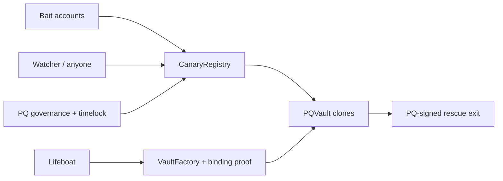

# Canary

A post-quantum safety layer for QoreChain: canaries raise an on-chain alarm,
PQ-Wrap vaults freeze classical authority, and Lifeboat helps users migrate
before an attack. Built for the QoreChain Developer Fest, Post-Quantum dApp track.

**Status: Phase 0 discovery. Discovery UI available; no deployed vaults or audit yet.**
Testnet only. No real funds. The full requirements are in
[the build prompt](Canary%20Full%20Product%20Build%20Prompt.md).

## What exists

- Official QoreChain Foundry scaffold and retained Vite web reference.
- A read-only Solidity probe for arbitrary native balances and real ML-DSA-87
  verification; no funded contract or mock deployed.
- A reproducible live testnet discovery script, unit/negative tests, Solidity
  fuzz tests, strict TypeScript check, and saved gas/chain evidence.
- A responsive Next.js discovery console for public account reads, QoreX-only
  connection and browser-local PQ compatibility checks. It sends no transactions.
- [Discovery](docs/DISCOVERY.md), [architecture](docs/ARCHITECTURE.md),
  [progress](docs/PROGRESS.md), [threat model](docs/THREAT_MODEL.md) and
  [AI contribution log](AI_USAGE.md).

## Run discovery

Node 20+ (tested with 22.13.1), npm, Git. On Windows the official Forge 1.7.1
platform binary is installed as an optional dependency. On Linux/macOS install
Forge 1.7.1 separately. Commands below work from the repository root.

```powershell
npm ci
node scripts/forge.mjs install foundry-rs/forge-std@v1.9.7 --no-git
npm run test:discovery
npm run typecheck
node scripts/forge.mjs test -vv
node scripts/forge.mjs fmt --check
npm run discovery
```

The final command uses only public testnet reads and simulations. It saves
`docs/evidence/discovery.json` and broadcasts nothing. No wallet is needed.
Contract deployment is a later wallet-local step; see the discovery checkpoint.

## Planned architecture



The discovery web app is Next.js/React; the official Vite template under
`.starter/` remains reference material. Full vault and migration screens are pending.

## Preview the discovery page

```powershell
npm run dev
```

Open http://127.0.0.1:3000 on the development computer. `npm run build` creates
the production build. `npm run test:web` runs desktop and mobile-viewport browser
checks (Windows uses installed Edge; other platforms need Playwright Chromium).
QoreX mobile requires a public HTTPS preview; localhost is not accessible as a
phone wallet test link. No preview is published yet.

The human selected **QoreX mobile only**. A native session-key route is being
investigated and remains disabled. [Integration findings](docs/QOREX_INTEGRATION.md).

## Limits and security

A drain is evidence of compromise, not proof of a quantum computer. Key copies,
operational compromise and correlated ceremony errors are alternatives. Neither
private-key destruction nor perfect detection is provable. An attacker can
race the alarm or top up canaries to mask a drain. Limits and delays reduce the
first-loss window; they cannot eliminate it. A PQ exit still needs an available
verifier, funded submitting account, RPC inclusion and a secure rescue address.
See [the threat model](docs/THREAT_MODEL.md).

The official Q-Day Drill predates this project's start. Our planned drill is a
separate, clearly labeled testnet simulation.

## Deployment and audit

No deployed contract addresses or Canary-generated transaction hashes yet.
The human's funded testnet account and an existing chain-verified hybrid transfer
are recorded in [the integration findings](docs/QOREX_INTEGRATION.md).
Read-only simulation is not a deployment.
The explorer currently has no source verification API; source and exact compiler
settings will be published with real receipts. [Audit status and required
two-stage QCAI evidence](docs/AUDIT.md). No external audit completed.

Current validation: 10 browser checks, 8 Node discovery tests and 8 Foundry tests passed (including
the original starter's 3 tests); two fuzz tests ran 256 cases each. This is not
validation of the unimplemented vault. [Gas measurement](docs/gas.md).

## Credits

- QoreChain `create-qorechain-dapp` 0.14.0: Foundry scaffold, Counter example,
  native window helper and retained fullstack-web reference; upstream Apache-2.0
  SPDX notices retained. https://github.com/qorechain/qorechain-sdk
- `@qorechain/sdk` and `@qorechain/evm`: official account, native hybrid signing
  and EVM window helpers. Same repository and Apache-2.0 terms.
- `@qorechain/pqc` 0.2.3 (Apache-2.0), wrapping noble's standard cryptography:
  https://github.com/qorechain/qorechain-pqc
- viem (MIT), Solidity compiler (GPL-3.0 tool), Foundry (MIT/Apache-2.0),
  forge-std v1.9.7 (MIT/Apache-2.0), TypeScript (Apache-2.0), tsx (MIT),
  CosmJS (Apache-2.0), and Node.js (MIT): development/integration dependencies.
- Retained web reference uses React/React DOM (MIT) and Vite (MIT).
- Discovery UI: Next.js 16.4.6 and React/React DOM 19.3.1 (MIT);
  `@qorechain/qorex-types` 0.1.0 (Apache-2.0); Playwright 1.65.1
  (Apache-2.0). https://github.com/qorechain/qorex-integrations
- OpenZeppelin is specified for later core contracts; it is not yet installed
  or claimed as an implemented integration.

New Canary code: [MIT](LICENSE). Retained upstream files keep their original
license notices. AI-generated work and human decisions: [AI_USAGE.md](AI_USAGE.md).
