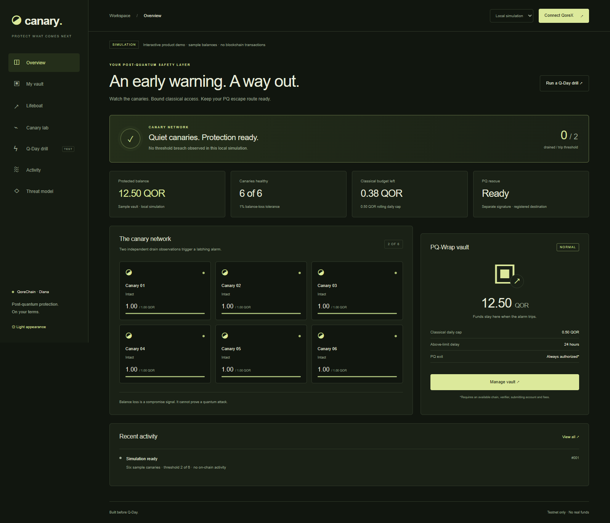
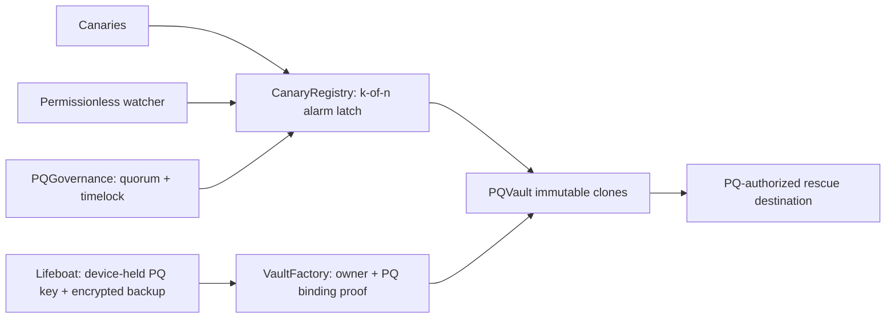

# Canary

**An early warning. A way out.** A post-quantum safety layer for QoreChain:
canaries trigger a latching alarm, PQ-Wrap vaults freeze classical fund release,
and Lifeboat guides migration into a separately PQ-authorized vault.

Built for the QoreChain Developer Fest, Post-Quantum dApp track.
**Working testnet prototype. Both QCAI stages reviewed; testnet only.**

**Coverage is finite:** ordinary QoreChain window renewal needs both classical
and PQ signatures. A PQ key alone cannot renew a canary after its classical key
is destroyed. The app and watcher now show coverage epochs, expiry and k+1
feasibility separately from the drain alarm. The original drill windows have
expired; historical alarm/rescue proof is not continuous current coverage.
See [verified epoch design](docs/CANARY_EPOCHS.md).

**Revision 2 deployed and activated:** registry source supports
timelocked, governance-only slot replacement with permanent address-use history.
It preserves old threshold evidence before replacement/retirement. The historical
demo is immutable and uses revision 1 from commit `287b799`. The separate
revision-2 deployment and real PQ withdrawal are recorded in
[testnet-v2.json](deployments/testnet-v2.json). Runtime comparisons passed;
three retained-key drill canaries were activated through PQ governance. The
hosted app uses revision 2 and labels revision-1 drill receipts as historical.



## What works today

- **Real deployed contracts:** CanaryRegistry, 2-of-3 PQGovernance, VaultFactory
  and an immutable PQVault clone, using the chain's real ML-DSA-87 precompile.
- **Real testnet drill:** normal classical withdrawal; two retained-key canary
  drains; permissionless watcher alarm; decoded `ClassicalFrozen` rejection;
  successful PQ rescue of the remaining vault balance.
- **Product UI:** overview, vault controls, nine-step Lifeboat simulation, ceremony
  draft, interactive Q-Day drill, activity and threat model; light/dark and mobile.
- **Live dashboard:** reads actual registry/canary/vault state and deployment
  receipts. Local simulation is explicitly separate, never a live-data fallback.
- **Browser PQ:** real ML-DSA-87 signing and AES-256-GCM encrypted backups using
  PBKDF2-SHA256 (310,000 iterations); encrypted blobs only in IndexedDB.
- **Watcher:** block subscription plus HTTP fallback/backoff, SQLite history,
  permissionless alarm submission, `/status`, `/health`, and `--once`.
- **Live workspace:** discover owned vaults, native/fUSD/user-added token
  balances, scoped allowance review, and decoded on-chain activity. Export
  selected, preflight-checked revocation plans without claiming they were sent.
- **Recovery:** restore encrypted backups from file or IndexedDB, check vault
  key binding, unlock locally for five minutes, and export a real PQ rescue
  authorization only after local signature verification and chain preflight.
- **Resume records:** save/export public owner/vault/key/policy snapshots and
  receipt references; imported labels never establish completion.

The browser's migration and transfer controls are **local simulation**. Live
testnet mode currently monitors the operator-owned demonstration; general-user
wallet-backed migration/transactions, production bounds and audits remain open.
QoreX connects through its documented native provider; no unsupported EVM send
or QR/WalletConnect capability is invented. No user wallet key was provided.

## Run the app

Node **22.13+**, npm and Git. Windows uses the pinned official Forge 1.7.1 npm
platform binary; install Forge 1.7.1 separately on Linux/macOS.

```powershell
npm ci
node scripts/forge.mjs install foundry-rs/forge-std@v1.9.7 --no-git
npm run dev
```

Open http://127.0.0.1:3000 for the interactive product simulation, or
http://127.0.0.1:3000/?mode=testnet for the live deployed demonstration.
`npm run build` creates the production build. The local URL is for the development
computer; QoreX mobile needs a publicly reachable HTTPS deployment.

## Actual testnet deployment

Network: `qorechain-diana`, EVM chain ID **9800**. Every transaction/receipt is
recorded in [deployments/testnet.json](deployments/testnet.json).

| Contract | Address |
| --- | --- |
| PQGovernance | `0xb933dc8be7b7044049e368c4ae61c2cad69fb952` |
| CanaryRegistry | `0x3a6d15b3cf0b65c5e6db6217d353508136988ec9` |
| VaultFactory | `0x1d8cfb8bdd89021ead9c7c42f929d35d7452dfac` |
| PQVault demo clone | `0x7ff8A9F57f638A4347146687e1ef4F5b54E89Ae6` |

**DEMO BOUNDS:** 60-second governance/minimum vault timelock; 10-second minimum
cooling-off. Not production settings. The three governance keys are retained by
one local demo operator, not three independent human guardians. Drill canary
keys are deliberately retained; there is no destruction claim.

The demonstration currently has **alarm latched, two of three canaries drained,
PQ nonce 2, and zero vault balance after rescue**. Reset requires PQ governance
and a delay; refreshing the UI cannot reset the chain.

Key proof transactions (select testnet in the explorer):

- [Watcher alarm](https://explore.qore.network/tx/0xa7ebd09c693290bb8ff112043836dc7dc13dced1066429047bed76b2c3922c5d)
- [PQ rescue during alarm](https://explore.qore.network/tx/0xed5f13dc0c0780f0756796488f625ccf9499468ff3e4c767cf24e2e4f518e27b)
- [Normal classical withdrawal](https://explore.qore.network/tx/0xbec48802acb2354baeba97950c78e320d33c521994ed3f214154233848b491e4)

Classical rejection was decoded as `ClassicalFrozen` during preflight; the known
failing transaction was **not broadcast**, and the vault balance stayed unchanged.
[Raw drill evidence](docs/evidence/live-drill.json). Recheck actual code/receipts
without signing:

```powershell
node scripts/product-smoke.mjs
```

## Architecture



Classical withdrawals use exact bounded rolling-24-hour accounting: at most
64 classical releases per token in the window; exceeding that bound fails
closed. Higher transfers require a timelock. An alarm permanently invalidates
earlier pending classical requests even after governance resets the alarm.
Registry failure/incomplete setup freezes classical release. PQ rescue can be
submitted by anyone holding the exact valid payload; during alarm it must go
to the registered rescue address. Policy loosening/key rotation require PQ
authorization and delay; key rotation also proves the new key's possession.

## Tests

```powershell
npm run typecheck
npm run test:discovery
npm run test:pq
npm run test:watcher
node scripts/forge.mjs fmt --check
node scripts/forge.mjs test
npm run test:web
npm run test:coverage
npm run lint:solidity
npm run build
```

Current source: **39 Foundry tests** (22 core, 5 rotation, 5 probe, 7 invariants),
**8 discovery tests**, **3 PQ client tests**, **2 coverage tests**,
**2 watcher integration tests**, and **18 desktop/mobile browser tests**.
Each invariant ran 256 campaigns of 500
actions. Browser tests use isolated test providers; they are not a claim of
real QoreX extension/mobile signing. PQ cryptography in browser tests is real.
Nonces and pre-alarm requests also have invariant coverage; cross-chain/cross-vault
replay have unit coverage. Full external audits are still required. [Gas evidence](docs/gas.md).

On non-Windows platforms, install Playwright Chromium with
`npx playwright install chromium`; Windows tests use installed Edge. CI runs
these checks; hosted CI has not yet been run for this local repository.

## Run the watcher

```powershell
Copy-Item services/watcher/.env.example services/watcher/.env
# Set CANARY_REGISTRY_ADDRESS in that local file.
node --env-file=services/watcher/.env --import tsx services/watcher/src/index.ts --once
node --env-file=services/watcher/.env --import tsx services/watcher/src/index.ts
```

Health/status bind to `127.0.0.1:8787` by default. Without a bot key it observes
and records submission-needed alerts; it never pretends to submit a transaction.
A testnet bot needs its own registered PQ key and live EVM window. Its classical
transaction key has no registry privilege. The service never needs a user's PQ
secret. Dockerfile: `services/watcher/Dockerfile` (build from repository root).

## Local deployment workflow

These scripts use **fresh local testnet keys** in ignored `.local/`, not the
human's QoreX seed. Never share or commit that directory. Funding was authorized
and supplied by the human; real funds are never used.

```powershell
node scripts/prepare-deployer.mjs
node scripts/deploy-testnet.mjs
node scripts/seed-demo-vault.mjs
node scripts/seed-drill-canaries.mjs
node scripts/run-testnet-drill.mjs
```

Scripts simulate calls before broadcasting, check receipt success and persist
actual hashes. The initial contract-creation window has no target restriction;
it is bounded in blocks/transactions/value and replaced immediately with a
target-scoped window. Subsequent helper windows include only reviewed targets.
The one-time alarm drill is not a chain reset tool; use governance for reset.

Add the fresh deployer `qor1mqfp8mfhqwpf8sc26850r94qarahf4ryfjvdpp` to the project
page alongside the registered QoreX account, then Check again. The official FAQ
permits multiple project addresses. [Submission checklist](docs/SUBMISSION.md).

## Limits and remaining work

A drain signals compromise, not proof of a quantum computer. Key destruction
cannot be proved. Attackers can race detection or top up canaries to mask a drain.
Daily limits do not bound matured, queued large withdrawals. Rescue depends on
chain availability, gas, transaction inclusion, the verifier and a secure rescue
address. Rebasing and fee-on-transfer tokens are unsupported; observed deposit
deltas do not prove future token behavior.

The deployed revision-1 registry has 16 lifetime slots, including retired
entries. Revision-2 slot rotation is locally tested and requires review plus a
new deployment. It cannot change existing immutable vaults. Rolling transfer
capacity, governance operations and rescue UX need additional hardening.
General-user live Lifeboat transactions, actual approval revocation, complete
ceremony, production-bounds deployment, two-stage QCAI, public hosting,
public repository and the final demo video remain incomplete.

Slither 0.11.5 completed on revision 2 with **37 findings**, all individually mapped in
[static analysis review](audit/slither.md). Solhint 6.2.5 reports zero errors
and eight reviewed warnings. Neither is an independent audit or a QCAI stage.
Install `audit/requirements.txt` into `.local/audit-venv`, then run
`npm run audit:static`. The compiled, flattened QCAI input is in `audit/qcai/`;
Stage 1 completed on 21 November 2026 (72/100, medium risk). All five findings
have documented dispositions in [the audit response](docs/AUDIT.md). Stage 2
completed on 23 November (72/100, medium); all five findings have dispositions.
Both original PDFs are in docs/audit/. Automated reviews are not independent security audits.

Canary Lab's local script fallback is documented in [CEREMONY.md](docs/CEREMONY.md).
Fresh unfunded preparation/status and three refusal guards are verified. Its
funding/exposure/governance/destruction flow has not been exercised; it never
accepts a personal wallet export or claims provable key destruction.

## Recover without giving the relay your key

In Live testnet → My vault/Lifeboat, discover the owner address and choose a
vault. Import its encrypted backup, unlock it locally, review the registered
rescue address and amount, then choose **Sign & check rescue authorization**.
The downloaded public authorization expires in five minutes and binds the
chain, vault, current nonce, recipient and amount. Its signature cannot be used
for another transaction. Keep your encrypted backup and password separate.

The local relay can check this public file without reading any signing key:

```powershell
node scripts/pq-rescue.mjs path/to/canary-pq-rescue-authorization.json
```

Adding `--submit` uses the fresh local testnet operator's own gas account,
opens a 30-block/one-transaction window scoped to the exact vault, simulates
again and broadcasts. No user PQ secret is accepted. This helper has syntax
and browser-payload verification; its new `--submit` path has not been exercised
live. The earlier real testnet drill used `run-testnet-drill.mjs` instead.

## Hosting preparation

`apps/web/Dockerfile`, `compose.yaml` and `.dockerignore` prepare the web app and
persistent read-only-by-default watcher without copying `.local/` or secrets.
Docker's engine was unavailable on the build machine, so container execution
has not been verified. No public deployment was made. QoreX mobile still needs
a public HTTPS URL. Docker Compose's watcher has no signer configured; health
means fresh RPC monitoring, while coverage degradation is reported separately.

See [threat model](docs/THREAT_MODEL.md), [architecture](docs/ARCHITECTURE.md),
[current progress](docs/PROGRESS.md), [audit status](docs/AUDIT.md),
[AI usage](AI_USAGE.md) and the [full build prompt](Canary%20Full%20Product%20Build%20Prompt.md).
The bundled atomic-creation eth_call gas failure is recorded in
[audit/rpc-simulation.md](audit/rpc-simulation.md); it is superseded as product
proof by actual successful deployments and transactions, not hidden as a pass.

## Credits and license

- QoreChain `create-qorechain-dapp` 0.14.0, SDK/EVM 0.14.0 (Apache-2.0): official
  scaffolds and native window/signing helpers. Retained examples under `.starter/`;
  Counter was removed from shipping contract paths. https://github.com/qorechain/qorechain-sdk
- `@qorechain/pqc` 0.2.3 and its noble backend (Apache-2.0 / MIT): standard
  ML-DSA-87. Public upstream vectors retain attribution under `docs/evidence/`.
  https://github.com/qorechain/qorechain-pqc
- `@qorechain/qorex-types` 0.1.0 (Apache-2.0): wallet detection/provider types.
  https://github.com/qorechain/qorex-integrations
- OpenZeppelin Contracts **5.6.1** (MIT): SafeERC20, storage ReentrancyGuard,
  EIP-1167 Clones. https://github.com/OpenZeppelin/openzeppelin-contracts
- Next.js 16.4.6, React/React DOM 19.3.1, viem, qrcode (MIT); Playwright 1.65.1
  (Apache-2.0); TypeScript (Apache-2.0), tsx (MIT), CosmJS (Apache-2.0),
  Foundry 1.7.1 / forge-std v1.9.7 (MIT/Apache-2.0), solc 0.8.28 (GPL-3.0 tool),
  Node.js (MIT, including SQLite runtime). The archived web reference uses Vite (MIT).
- Slither 0.11.5 (AGPL-3.0 analyzer) and solhint 6.2.5 (MIT linter) are local
  development tools; their reports and triage do not substitute for an audit.

New Canary code: [MIT](LICENSE). Upstream files retain original notices. No
mock verifier has been deployed. AI/human contributions: [AI_USAGE.md](AI_USAGE.md).
