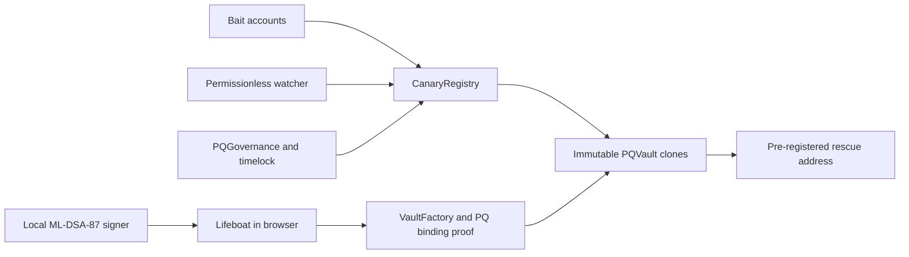

# Canary architecture — deployed prototype

Status as of 21 November: core contracts are implemented and deployed on Diana
with short demo bounds, plus a real watcher-triggered alarm/PQ-rescue drill.
The browser has an interactive simulation and read-only live dashboard.
General-user live migration is not complete; no external audit has been run.
The build prompt remains the full product specification.

The human now has QoreX extension and mobile, and funded a fresh, local testnet
deployer. No personal key was supplied. A separate wallet app is not required
for deployment. User-facing QoreX EVM transport is still unresolved; no hidden
session permissions or invented QR connection are enabled.

## Verified integration boundaries

- Testnet: native `qorechain-diana`, EVM chain id `9800`. No mainnet deployment.
- Compiler: Solidity 0.8.28, optimizer enabled, 200 runs, Paris EVM target.
- The real verifier is `0x0000000000000000000000000000000000000a01`.
  ABI order is **public key, signature, message**. Empty output must revert.
- ML-DSA-87 keys/signatures are 2,592/4,627 bytes. Vault storage holds the
  keccak256 key hash, not the full key. This differs from the PQ library's
  `pubkeyHash` helper, which uses SHAKE-256; do not substitute that helper.
- Every ordinary EVM sender needs an ML-DSA key registered on the native lane
  and a bounded EVM authorisation window. Keep the signed window request as
  evidence, not just REST readback; some scope fields are absent in readback.
- Window creation uses a native hybrid signature. EVM calls themselves use
  classical transaction signatures, even if their contract payload is PQ signed.
- The official Foundry scaffold is in `contracts/`. Its untouched web reference
  is in `.starter/fullstack-web/`; it is Vite, not Next.js. Canary's planned web
  app remains Next.js in `apps/web/`, informed by the verified starter APIs.

## Implemented security choices and remaining review

1. PQ withdrawals must be permissionless to submit: authority comes from the
   payload, not `msg.sender`. A separate funded sender with its own live window
   can relay when the owner's window is expired. RPC censorship, verifier
   availability, fees and rescue-account security still constrain liveness.
2. Read both alarm state and the last alarm block under fail-closed handling.
   Give the registry reads bounded gas so a failing call cannot consume all gas.
3. Check for drained canaries synchronously before classical fund release, in
   addition to the watcher. Otherwise the attacker can race watcher inclusion.
   This mitigates but does not eliminate the first-loss window or top-up masking.
4. Rolling spend uses 64 timestamped entries per token; no midnight reset. A full
   live ring denies another classical release until a slot expires. UI warns
   that matured large requests can exceed the daily allowance.
5. Alarm history invalidates every earlier queued classical withdrawal even
   after reset. Same-block requests should be conservatively invalidated.
6. PQ-authorised policy loosening and key rotation require a nonce, deadline,
   action-specific domain, chain id, vault address and timelock. Key rotation
   should prove control of the replacement key before it can become active.
7. Owner-originated deposits open the cooling-off reversal window. Reversal is
   owner-directed and uses the same alarm/lock/daily accounting as classical
   withdrawal. Third-party deposits do not extend the owner's reversal window.
8. Unsupported token behavior cannot be identified completely by one deposit
   delta check. Rebases and changing token behavior remain an explicit exclusion.
9. Minimal clones delegate to an immutable implementation by design; the prompt's
   prohibition on delegatecall applies to vault implementation code, not the
   required EIP-1167 dispatch mechanism. No arbitrary delegated execution.

These choices are covered by unit/invariant tests and the real testnet drill;
they are not an external security audit. Production slot recycling for the
registry and operational governance review remain required. Demo governance
keys are held by one local operator, not independent people.

## Repository components

`contracts/`: registry, PQ governance, factory, vault, unit/fuzz/invariant tests.
`packages/pq/`: typed local signer and encrypted backup, known-vector tests.
`services/watcher/`: block-driven checks, SQLite snapshots, health/status, retry.
`apps/web/`: dashboard, vaults, Lifeboat, ceremony, labeled drill, docs/activity.
`scripts/`: deployment/ceremony/seed/drill, each testnet guarded and simulated.
`deployments/testnet.json`: only real receipts, never placeholder addresses.

## References

- https://docs.qorechain.io/developer-guide/evm-precompiles/
- https://docs.qorechain.io/developer-guide/evm-window-reference/
- https://github.com/qorechain/qorechain-pqc
- https://build.qorechain.io/faq
